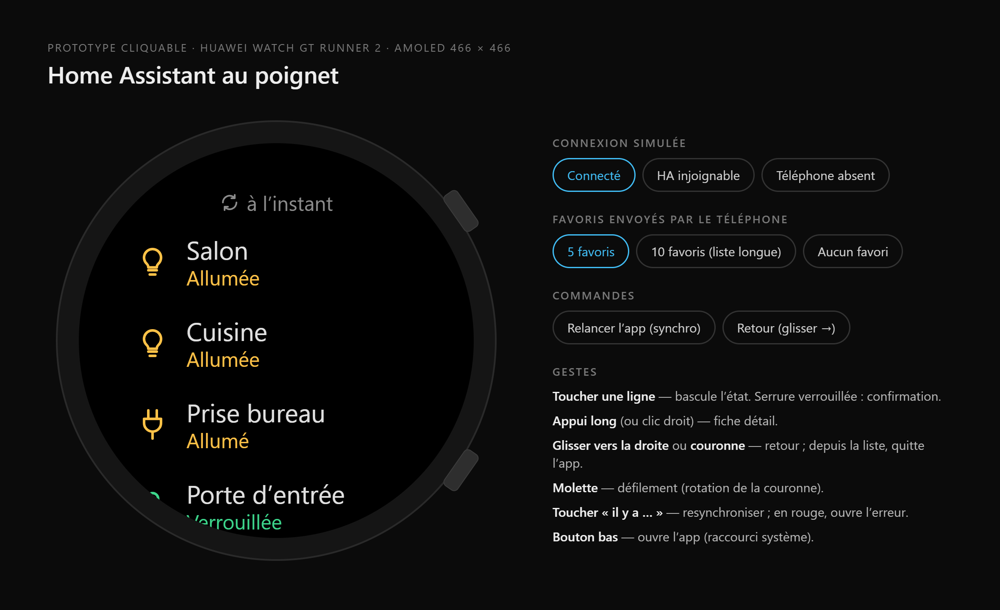
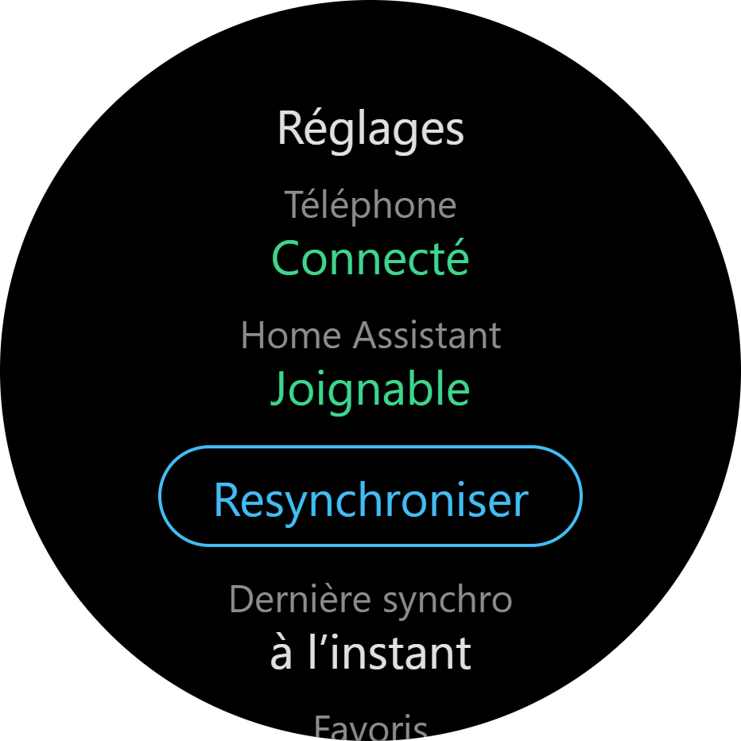
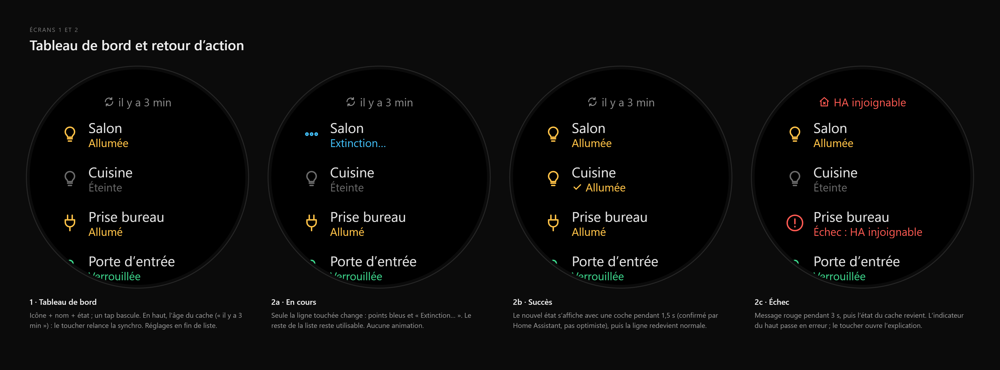
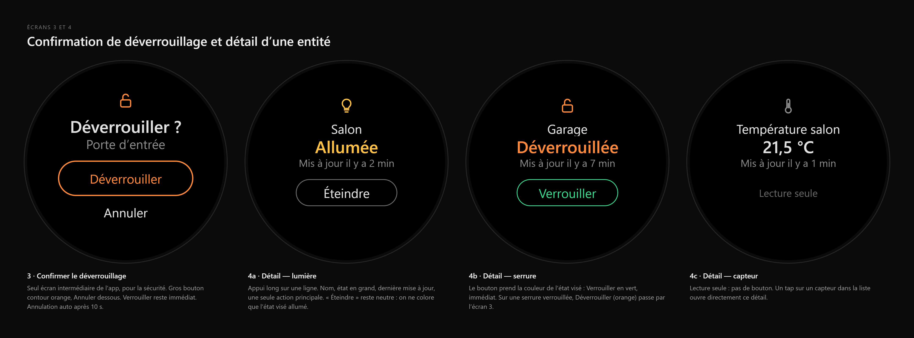
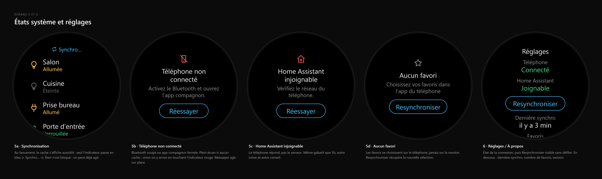
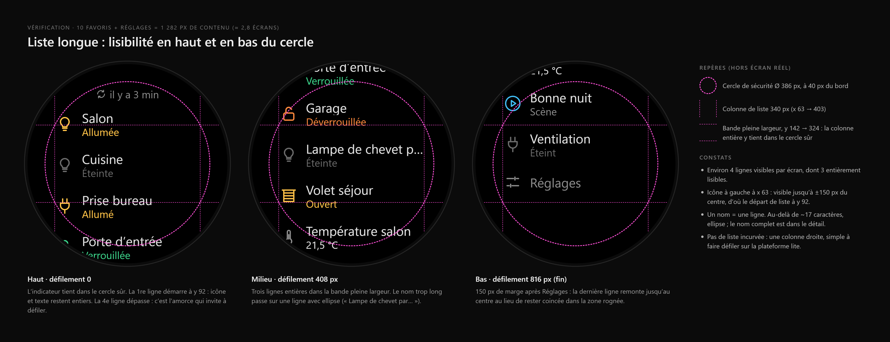
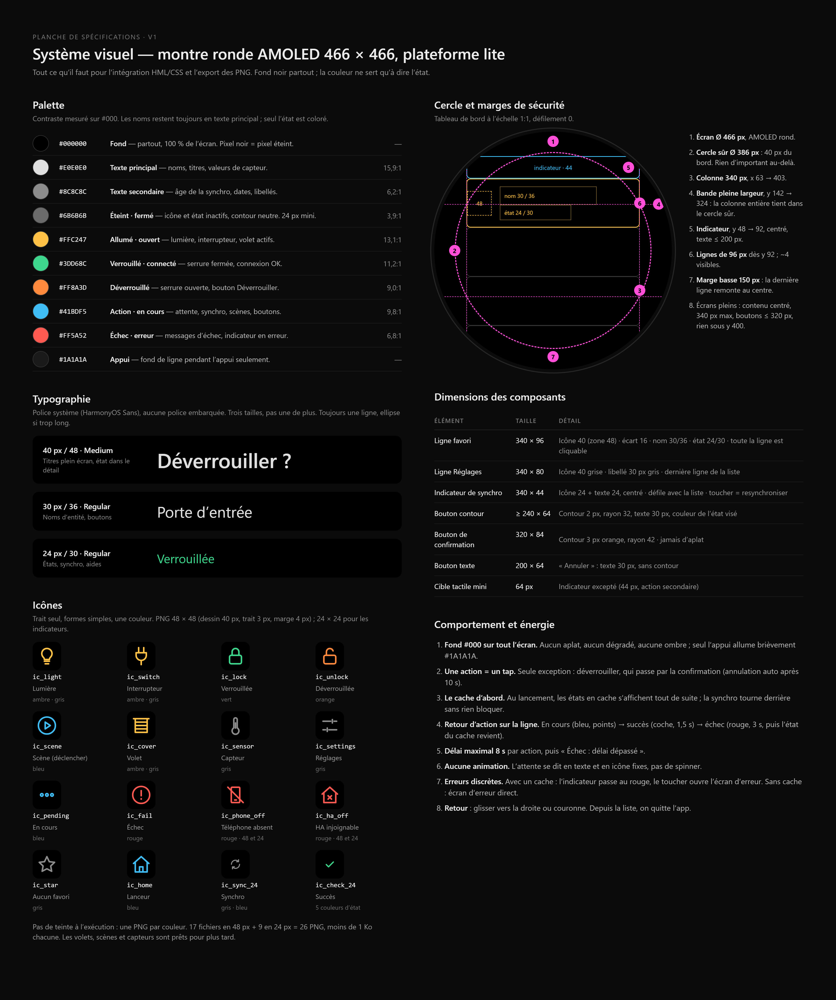

# Maquette — app montre lite (Watch GT Runner 2)

Export Claude Design « HA Montre ronde », planche de spécifications v1. Cible : écran AMOLED rond
466 × 466 de la Huawei Watch GT Runner 2, plateforme **lite** (HML / CSS / JS ES5.1), donc
l'app [`apps/watch-lite/`](../../../apps/watch-lite/README.md).

Ce dossier ne contient que la référence visuelle : aucune ligne de code de l'app n'en dépend.
Les valeurs ci-dessous sont relevées dans les sources de l'export (styles et logique du composant
écran), pas mesurées sur les captures.

| Fichier | Contenu |
|---------|---------|
| [`ha-montre-ronde.html`](ha-montre-ronde.html) | Export complet : prototype cliquable et toutes les planches. À ouvrir dans un navigateur (JavaScript requis). |
| [`ha-montre-ronde.pdf`](ha-montre-ronde.pdf) | Les 7 planches en PDF. |
| [`screens/`](screens/) | Une capture PNG par planche (rendu ×2). |

## Écrans

### Prototype cliquable

Simule la connexion (connecté, HA injoignable, téléphone absent) et le nombre de favoris
(5, 10 ou aucun). Les commandes « Relancer l'app » et « Retour » rejouent la synchro et le geste
retour.

### Composant écran

Un seul composant 466 × 466 sert à tous les écrans ci-dessous. Ici : le tableau de bord à
l'échelle 1:1.

### Écrans 1–2 · Tableau de bord et retour d'action

| Écran | Contenu |
|-------|---------|
| 1 · Tableau de bord | Icône + nom + état par favori ; un tap bascule. En haut, l'âge du cache (« il y a 3 min ») ; le toucher relance la synchro. Réglages en fin de liste. |
| 2a · En cours | Seule la ligne touchée change : points bleus et « Extinction… ». Le reste de la liste reste utilisable. |
| 2b · Succès | Nouvel état + coche pendant 1,5 s, confirmé par Home Assistant (pas d'affichage optimiste). |
| 2c · Échec | Message rouge pendant 3 s, puis l'état du cache revient. L'indicateur du haut passe en erreur. |

### Écrans 3–4 · Confirmation et détail

| Écran | Contenu |
|-------|---------|
| 3 · Confirmer le déverrouillage | Seul écran intermédiaire de l'app. Gros bouton contour orange « Déverrouiller », « Annuler » dessous. |
| 4a · Détail — lumière | Nom, état en grand, « Mis à jour il y a … », une seule action principale. |
| 4b · Détail — serrure | Le bouton prend la couleur de l'état visé : « Verrouiller » en vert, « Déverrouiller » en orange (passe par l'écran 3). |
| 4c · Détail — capteur | Lecture seule, pas de bouton. |

### Écrans 5–6 · États système et réglages

| Écran | Contenu |
|-------|---------|
| 5a · Synchronisation | Le cache s'affiche tout de suite ; seul l'indicateur passe en bleu (« Synchro… »). |
| 5b · Téléphone non connecté | Bluetooth coupé ou app compagnon fermée. |
| 5c · Home Assistant injoignable | Le téléphone répond, pas le serveur. Même gabarit que 5b. |
| 5d · Aucun favori | Les favoris se choisissent sur le téléphone, jamais sur la montre. |
| 6 · Réglages / À propos | État de la connexion, « Resynchroniser » visible sans défiler, puis dernière synchro, nombre de favoris, version. |

### Variante liste longue · 10 favoris

10 favoris + Réglages = 1 282 px de contenu (≈ 2,8 écrans), montrés aux défilements 0, 408 et
816 px (fin). Environ 4 lignes visibles par écran, dont 3 entières. Les repères roses sont des
aides de mise en page, absents de l'écran réel.

### Planche de spécifications

Source des sections qui suivent.

## Palette

Fond noir partout : un pixel noir est un pixel éteint sur l'AMOLED. La couleur ne sert qu'à dire
l'état ; les noms restent toujours en texte principal.

| Hex | Rôle | Usage | Contraste sur #000 |
|-----|------|-------|--------------------|
| `#000000` | Fond | Tout l'écran. | — |
| `#E0E0E0` | Texte principal | Noms, titres, valeurs de capteur. | 15,9:1 |
| `#8C8C8C` | Texte secondaire | Âge de la synchro, dates, libellés, icône Réglages. | 6,2:1 |
| `#6B6B6B` | Éteint · fermé | Icône et état inactifs, contour neutre. 24 px minimum. | 3,9:1 |
| `#FFC247` | Allumé · ouvert | Lumière, interrupteur, volet actifs. | 13,1:1 |
| `#3DD68C` | Verrouillé · connecté | Serrure fermée, connexion OK. | 11,2:1 |
| `#FF8A3D` | Déverrouillé | Serrure ouverte, bouton Déverrouiller. | 9,0:1 |
| `#41BDF5` | Action · en cours | Attente, synchro, scènes, boutons. | 9,8:1 |
| `#FF5A52` | Échec · erreur | Messages d'échec, indicateur en erreur. | 6,8:1 |
| `#1A1A1A` | Appui | Fond de ligne pendant l'appui seulement. | — |

Correspondance état → rendu (ligne de liste) :

| Domaine | État | Icône | Couleur | Texte d'état |
|---------|------|-------|---------|--------------|
| `light` | on / off | `ic_light` | `#FFC247` / `#6B6B6B` | Allumée / Éteinte |
| `switch` | on / off | `ic_switch` | `#FFC247` / `#6B6B6B` | Allumé / Éteint |
| `lock` | locked | `ic_lock` | `#3DD68C` | Verrouillée |
| `lock` | unlocked | `ic_unlock` | `#FF8A3D` | Déverrouillée |
| `cover` (plus tard) | open / closed | `ic_cover` | `#FFC247` / `#6B6B6B` | Ouvert / Fermé |
| `scene` (plus tard) | — | `ic_scene` | icône `#41BDF5`, texte `#8C8C8C` | Scène (puis « Lancée » en bleu) |
| `sensor` (plus tard) | valeur | `ic_sensor` | icône `#8C8C8C`, texte `#E0E0E0` | la valeur, ex. « 21,5 °C » |
| tous | en cours | `ic_pending` | `#41BDF5` | Allumage… · Extinction… · Verrouillage… · Déverrouillage… · Ouverture… · Fermeture… · Lancement… |
| tous | échec | `ic_fail` | `#FF5A52` | Échec : HA injoignable · Échec : tél. déconnecté · Échec : délai dépassé |

## Typographie

Police système (HarmonyOS Sans), aucune police embarquée. Trois tailles, pas une de plus.
Toujours une ligne, avec une ellipse si le texte est trop long.

| Taille / interligne | Graisse | Usage | Exemple |
|---------------------|---------|-------|---------|
| 40 px / 48 | Medium | Titres plein écran, état dans le détail | « Déverrouiller ? » |
| 30 px / 36 | Regular | Noms d'entité, boutons, titres d'écran | « Porte d'entrée » |
| 24 px / 30 | Regular | États, synchro, aides, libellés | « Verrouillée » |

Un nom de favori tient sur une ligne jusqu'à environ 17 caractères ; au-delà, ellipse
(« Lampe de chevet par… »). Le nom complet est dans le détail.

## Cercle 466 × 466 et marges de sécurité

| Repère | Valeur | Règle |
|--------|--------|-------|
| Écran | Ø 466 px | AMOLED rond. |
| Cercle sûr | Ø 386 px, à 40 px du bord | Rien d'important au-delà. |
| Colonne de liste | 340 px, x 63 → 403 | Marge latérale 63 px. |
| Bande pleine largeur | y 142 → 324 | La colonne entière y tient dans le cercle sûr. |
| Indicateur de synchro | y 48 → 92 (44 px) | Centré, texte ≤ 200 px. |
| Lignes de favoris | 96 px, dès y 92 | ~4 visibles. L'icône à x 63 reste visible jusqu'à ±150 px du centre, d'où le départ à y 92. |
| Marge basse de la liste | 150 px après Réglages | La dernière ligne remonte au centre au lieu de rester dans la zone rognée. |
| Écrans pleins | contenu centré, 340 px max | Boutons ≤ 320 px, rien sous y 400. |

Marges intérieures par écran :

| Écran | Padding |
|-------|---------|
| Liste (tableau de bord) | 48 haut · 63 côtés · 150 bas, défilante |
| Détail | 76 haut · 63 côtés |
| Confirmation | 64 haut · 63 côtés |
| Réglages | 60 haut · 63 côtés · 150 bas, défilante, 16 px entre blocs |
| Erreur, aucun favori | centré verticalement · 73 côtés (320 px utiles) |

Enchaînement vertical sur les écrans pleins : icône (zone 48) → 12 px → titre → message (8 px
sur les écrans d'erreur) → 24 px → bouton. Confirmation : 22 px avant « Déverrouiller », 6 px
avant « Annuler ».

## Dimensions des composants

| Élément | Taille | Détail |
|---------|--------|--------|
| Ligne favori | 340 × 96 | Icône 40 (zone 48) · écart 16 · nom 30/36 · état 24/30 · toute la ligne est cliquable. |
| Ligne Réglages | 340 × 80 | Icône 40 grise · libellé 30 px gris · dernière ligne de la liste. |
| Indicateur de synchro | 340 × 44 | Icône 24 + écart 8 + texte 24, centré · défile avec la liste. |
| Bouton contour | ≥ 240 × 64 | Contour 2 px, rayon 32, texte 30 px, couleur de l'état visé (neutre : contour `#6B6B6B`, texte `#E0E0E0`). |
| Bouton de confirmation | 320 × 84 | Contour 3 px orange, rayon 42, jamais d'aplat. |
| Bouton texte | 200 × 64 | « Annuler » : texte 30 px, sans contour. |
| Cible tactile minimale | 64 px | Sauf l'indicateur (44 px, action secondaire). |

## Icônes

Trait seul, formes simples, une couleur. Pas de teinte à l'exécution : **une PNG par couleur**.

- **48 × 48** : dessin 40 px, trait 3 px, marge 4 px.
- **24 × 24** : indicateurs (trait 2 px ; 2,4 px pour la coche).
- 17 fichiers en 48 px + 9 en 24 px = **26 PNG**, moins de 1 Ko chacune.

L'export ne contient pas de fichiers d'icônes : elles y sont dessinées en SVG. Les 26 PNG sont
générées à partir des tracés ci-dessous par
[`apps/watch-lite/tools/icons/generate-icons.mjs`](../../../apps/watch-lite/tools/icons/generate-icons.mjs)
(`npm run icons`, sans dépendance, reproductible et vérifié par les tests), dans
`apps/watch-lite/entry/src/main/js/MainAbility/common/icons/`.

| Fichier | Taille | Usage | Couleurs (= nombre de PNG) |
|---------|--------|-------|-----------------------------|
| `ic_light` | 48 | Lumière | ambre `#FFC247`, gris `#6B6B6B` |
| `ic_switch` | 48 | Interrupteur | ambre, gris |
| `ic_lock` | 48 | Verrouillée | vert `#3DD68C` |
| `ic_unlock` | 48 | Déverrouillée | orange `#FF8A3D` |
| `ic_scene` | 48 | Scène (plus tard) | bleu `#41BDF5` |
| `ic_cover` | 48 | Volet (plus tard) | ambre, gris |
| `ic_sensor` | 48 | Capteur (plus tard) | gris `#8C8C8C` |
| `ic_settings` | 48 | Réglages | gris `#8C8C8C` |
| `ic_pending` | 48 | En cours | bleu |
| `ic_fail` | 48 | Échec | rouge `#FF5A52` |
| `ic_phone_off` | 48 | Téléphone absent (écran 5b) | rouge |
| `ic_ha_off` | 48 | HA injoignable (écran 5c) | rouge |
| `ic_star` | 48 | Aucun favori | gris `#8C8C8C` |
| `ic_home` | 48 | Lanceur (prototype) | bleu |
| `ic_sync_24` | 24 | Indicateur de synchro | gris `#8C8C8C`, bleu |
| `ic_phone_off_24` | 24 | Indicateur en erreur | rouge |
| `ic_ha_off_24` | 24 | Indicateur en erreur | rouge |
| `ic_check_24` | 24 | Succès | ambre, gris `#6B6B6B`, vert, orange, bleu |

La maquette ne fixe pas le nom des variantes de couleur. Elle dit seulement « 48 et 24 » pour
`ic_phone_off` et `ic_ha_off` : les noms `_24` ci-dessus reprennent la convention de `ic_sync_24`.

**Nom des fichiers : `<icône>_<rôle>.png`.** Le rôle est celui de la palette :

| Rôle | Couleur |
|------|---------|
| `on` | ambre `#FFC247` |
| `off` | gris `#6B6B6B` |
| `sub` | gris `#8C8C8C` |
| `lock` | vert `#3DD68C` |
| `unlock` | orange `#FF8A3D` |
| `act` | bleu `#41BDF5` |
| `err` | rouge `#FF5A52` |

Par exemple `ic_light_on.png`, `ic_light_off.png`, `ic_sync_24_act.png` ou `ic_check_24_lock.png`.
Les fichiers générés pèsent entre 165 et 419 octets. Ce sont des PNG indexées : une seule couleur, et
l'anticrénelage passe par la transparence.

Tracés SVG (viewBox 0 0 24 24, <code>fill: none</code>, extrémités et jonctions rondes)

Épaisseur dans la viewBox : 1,8 pour les icônes 48 (= 3 px à 40 px), 2 pour `ic_sync_24`,
`ic_phone_off_24` et `ic_ha_off_24`, 2,4 pour `ic_check_24`.

| Icône | `d` |
|-------|-----|
| light | `M9 18h6M10 21h4M12 3a6 6 0 0 0-4 10.5c.7.7 1 1.5 1 2.5h6c0-1 .3-1.8 1-2.5A6 6 0 0 0 12 3z` |
| switch | `M9 2v6M15 2v6M6 8h12v3a6 6 0 0 1-12 0zM12 17v5` |
| lock | `M7 11h10a2 2 0 0 1 2 2v6a2 2 0 0 1-2 2H7a2 2 0 0 1-2-2v-6a2 2 0 0 1 2-2zM8 11V7a4 4 0 0 1 8 0v4` |
| unlock | `M7 11h10a2 2 0 0 1 2 2v6a2 2 0 0 1-2 2H7a2 2 0 0 1-2-2v-6a2 2 0 0 1 2-2zM8 11V7a4 4 0 0 1 7.8-1.2` |
| scene | `M12 2a10 10 0 1 0 0 20a10 10 0 1 0 0-20zM10 8v8l6-4z` |
| cover | `M3 4h18M5 4v16h14V4M5 8h14M5 12h14M5 16h14` |
| sensor | `M14 14.8V5a2 2 0 0 0-4 0v9.8a4 4 0 1 0 4 0zM12 9v6` |
| settings | `M4 7h9M17 7h3M4 17h3M11 17h9M15 5v4M9 15v4` |
| pending | `M4.5 12a1.5 1.5 0 1 0 3 0a1.5 1.5 0 1 0-3 0zM10.5 12a1.5 1.5 0 1 0 3 0a1.5 1.5 0 1 0-3 0zM16.5 12a1.5 1.5 0 1 0 3 0a1.5 1.5 0 1 0-3 0z` |
| fail | `M12 2a10 10 0 1 0 0 20a10 10 0 1 0 0-20zM12 7v6M12 16.5v.5` |
| phone_off | `M8 3h8a1 1 0 0 1 1 1v16a1 1 0 0 1-1 1H8a1 1 0 0 1-1-1V4a1 1 0 0 1 1-1zM11 18h2M3 3l18 18` |
| ha_off | `M3 11l9-8 9 8M5 9.5V21h14V9.5M10 13l4 4M14 13l-4 4` |
| star | `M12 3l2.8 5.9 6.2.8-4.5 4.3 1.1 6.2L12 17.3 6.4 20.2l1.1-6.2L3 9.7l6.2-.8z` |
| home | `M3 11l9-8 9 8M5 9.5V21h14V9.5M10 21v-6h4v6` |
| sync | `M20 12a8 8 0 0 1-14 5.3M4 12a8 8 0 0 1 14-5.3M18 3v4h-4M6 21v-4h4` |
| check | `M5 12.5l4.5 4.5L19 7.5` |

## Règles d'interaction

**Gestes**

| Geste | Effet |
|-------|-------|
| Tap sur une ligne | Bascule l'état : lumière et interrupteur allumé ↔ éteint, volet ouvrir ↔ fermer, scène lancée. Serrure déverrouillée → verrouillage immédiat. Serrure verrouillée → écran de confirmation. Capteur → ouvre le détail. |
| Appui long sur une ligne | Ouvre le détail (550 ms dans le prototype). |
| Tap sur l'indicateur du haut | Resynchronise. S'il est rouge, ouvre l'écran d'erreur correspondant. Ignoré pendant une synchro. |
| Glisser vers la droite, ou couronne | Retour : détail, réglages ou erreur → liste ; confirmation → écran d'origine ; depuis la liste, quitte l'app. |
| Rotation de la couronne | Défilement. |
| Bouton bas | Ouvre l'app (raccourci système). |

**Actions**

- **Une action = un tap.** Seule exception : déverrouiller.
- **Confirmation du déverrouillage.** Écran 3 : « Déverrouiller ? », nom de la serrure, bouton
  contour orange « Déverrouiller », puis « Annuler ». Annulation automatique après 10 s. On revient
  à l'écran d'origine (liste ou détail), où la ligne passe « en cours ». Verrouiller reste immédiat.
- **Détail.** Une seule action principale, dans la couleur de l'état visé : Allumer (ambre),
  Éteindre (neutre), Verrouiller (vert), Déverrouiller (orange, via l'écran 3), Ouvrir (ambre),
  Fermer (neutre), Lancer (bleu). Capteur : « Lecture seule », pas de bouton. Pendant l'action, le
  bouton est grisé et inactif.
- **Retour d'action sur la ligne**, et seulement sur elle :
  1. en cours : icône points bleus, texte « Extinction… » (ou équivalent) ; un nouveau tap sur
     cette ligne est ignoré, le reste de la liste reste utilisable ;
  2. succès : nouvel état + coche pendant 1,5 s, seulement après confirmation de Home Assistant ;
  3. échec : icône et texte rouges pendant 3 s, puis l'état du cache revient et l'indicateur du
     haut passe en erreur.
- **Délai maximal 8 s** par action, puis « Échec : délai dépassé ».
- **Le cache d'abord.** Au lancement, les états en cache s'affichent tout de suite ; la synchro
  tourne derrière sans rien bloquer.
- **Aucune animation, aucun spinner.** L'attente se dit en texte et en icône fixes. Seul l'appui
  allume brièvement le fond de la ligne en `#1A1A1A`.

**États hors ligne, HA injoignable, aucun favori**

Avec un cache, une erreur reste discrète : l'indicateur passe au rouge et son toucher ouvre
l'écran d'erreur. Sans cache, l'écran d'erreur s'affiche directement.

| État | Indicateur (avec cache) | Écran plein | Bouton |
|------|-------------------------|-------------|--------|
| Synchro en cours | `ic_sync_24` bleu, « Synchro… » | — (la liste reste utilisable) | — |
| Synchro OK | `ic_sync_24` gris, « il y a 3 min » / « à l'instant » / « il y a 2 h » | — | — |
| Téléphone non connecté | `ic_phone_off_24` rouge, « Tél. déconnecté » | 5b : `ic_phone_off`, « Téléphone non connecté », « Activez le Bluetooth et ouvrez l'app compagnon. » | « Réessayer » (« Connexion… » pendant l'essai) |
| HA injoignable | `ic_ha_off_24` rouge, « HA injoignable » | 5c : `ic_ha_off`, « Home Assistant injoignable », « Vérifiez le réseau du téléphone. » | « Réessayer » |
| Aucun favori | — | 5d : `ic_star` gris, « Aucun favori », « Choisissez vos favoris dans l'app du téléphone » | « Resynchroniser » (« Synchro… ») |

« Réessayer » agit sur place : en cas de succès on revient à la liste, sinon on reste sur l'écran
d'erreur. Réglages (écran 6) : Téléphone « Connecté » (vert) ou « Déconnecté » (rouge) ; Home
Assistant « Joignable » (vert), « Injoignable » (rouge) ou « Inconnu » (gris) ; « Resynchroniser » ;
« Dernière synchro » ; « Favoris : N sur 10 » ; « Version ».

## Écarts avec la plateforme lite

Rappel des limites (détail dans [platform-constraints.md](../../platform-constraints.md)) : JS
**ES5.1** sur JerryScript, **~1 Mo de RAM**, page ≤ 48 Ko, HAP ≤ 10 Mo, **PNG décodées en RGBA brut**
dans le `.bin`, pas de flou, d'ombres ni de dégradés, **pas d'`ArcList`**, routeur sans pile de
retour, pas d'arrière-plan, état non restauré après redémarrage.

La maquette a été pensée pour le lite : pas de liste incurvée, pas d'animation, pas d'ombre, des
PNG par couleur. Il reste les écarts ci-dessous. ⚠ = comportement lite à confirmer sur la Runner 2
avant de s'appuyer dessus.

| Dans la maquette | Problème en lite | Alternative |
|------------------|------------------|-------------|
| Icônes SVG teintées par `stroke` | Le composant `image` lite n'accepte que PNG et JPG et ne teint pas les images ✓. | Les 26 PNG, une par couleur, fond transparent, générées à partir des tracés ci-dessus. |
| Icônes PNG 48 px (128 px dans l'app actuelle) | Une PNG coûte largeur × hauteur × 4 octets une fois décodée : 9 216 o en 48 px, 2 304 o en 24 px, 65 536 o pour les 128 px de `common/icons/`. | 48 px maximum, 24 px pour les indicateurs, jamais d'agrandissement par CSS. Les 26 PNG pèsent ≈ 173 Kio décodées. |
| Écran « off » : lanceur rond de 112 px avec `ic_home` | Simulation du lanceur système, pas un écran de l'app. | Ne pas l'implémenter. L'icône de l'app reste `resources/base/media/icon.png`, affichée par le système. |
| Police HarmonyOS Sans, graisse Medium en 40 px | Une seule police : `SourceHanSansSC-Regular` ; pas de `font-weight` sur `text` ✓. | 40 px Regular : la hiérarchie tient par la taille et la couleur. |
| Interlignes 48 / 36 / 30 | `line-height` existe sur `text` depuis l'API 10 ✓ (projet en API 18). | `line-height` + hauteur fixe sur chaque `text` (48, 36 ou 30 px) pour garder le rythme vertical ; rendu à comparer dans DevEco ⚠. |
| Espacement des lettres | `letter-spacing` vaut **2 px par défaut** sur `text` ✓. | `letter-spacing: 0px` partout, sinon les noms débordent. |
| Une ligne avec ellipse (`nowrap`, `text-overflow: ellipsis`) | Supportée par `text`, à condition d'avoir une largeur fixe ✓. | `width` fixe (276 px pour un nom de ligne = 340 − 48 − 16) + `text-overflow: ellipsis` ; en repli, coupe en JS (`ellipsize`) à ~17 caractères + « … ». |
| Titres et aides sur deux lignes (5b, 5c, 5d) | Retour à la ligne automatique peu fiable ⚠. | Deux `text` d'une ligne chacun (deux chaînes i18n), ou des textes raccourcis à une ligne. |
| `gap`, `min-width`, `max-width`, `inset`, `box-sizing`, `flex: 1` | Hors du sous-ensemble CSS lite ✓ (`npm run check` les refuse). | Marges explicites (`margin-left: 16px`…), largeurs fixes (240, 276, 320, 340), superposition par `stack` + `left`/`top`. |
| Bouton grisé par `opacity: 0.4` pendant l'action | `opacity` est supportée (API 5+) ✓. | Gardé tel quel : `opacity: 0.4` et tap ignoré pendant l'action ; rendu à vérifier ⚠. |
| Fond d'appui `#1A1A1A` (`:active`) | Événements lite : `click`, `longpress`, `swipe` seulement (pas de `touchstart`) ; `:active` n'existe que sur `input[type=button]`, pour `background-color` ✓. | **Pas de surbrillance d'appui** : la ligne passe tout de suite « en cours » (bleu), c'est le retour visuel. |
| Liste droite avec marges 48 en haut et 150 en bas | Pas d'`ArcList` ; le padding d'une `list` n'est pas forcément compté dans la zone de défilement. | `list` + `list-item` : un `list-item` vide de 48 px, l'indicateur (44 px), les favoris, Réglages, puis un `list-item` vide de 150 px. |
| Masque rond (`border-radius: 50%` + `overflow: hidden`) | Inutile : l'écran est physiquement rond. | Rien à faire ; respecter le cercle sûr. |
| Ombres des planches, repères roses, décalage `translateY` | Outils de présentation du prototype. | Ne pas les reproduire. Aucun flou, ombre ni dégradé sur la montre. |
| Appui long à 550 ms, clic droit | Seuil fixé par le système, pas de clic droit. | Événement `longpress` (seuil système). |
| Glisser vers la droite = retour | Routeur sans pile de retour. | `on:swipe` direction `right` → `router.replace` vers la page parente explicite ; depuis la liste, `app.terminate()`. |
| Confirmation et erreurs en écrans séparés | Chaque page est rechargée à la navigation et pèse au plus 48 Ko. | Blocs `if` / `show` dans la page courante (confirmation dans la liste ou le détail, erreurs dans la liste) : ni page, ni pile en plus. |
| Couronne = défilement et retour | Rotation de la couronne transmise à la `list` ⚠ ; l'appui sur la couronne appartient au système. | Défilement tactile en repli ; retour par glissement uniquement. |
| Bouton bas = ouvre l'app | Réglage système de l'utilisateur, hors de portée de l'app ⚠. | Le documenter pour l'utilisateur ; rien à coder. |
| Minuteries 1,5 s, 3 s, 8 s, 10 s | `setTimeout` fonctionne, mais tout s'arrête quand l'app quitte (pas d'arrière-plan). | Annuler les minuteries dans `onDestroy` ; à la reprise, repartir du cache. Une action interrompue n'est pas rejouée automatiquement. **Jamais de `setInterval`** (le lint le refuse). |
| « il y a 3 min » qui se met à jour | Il faudrait une minuterie périodique (batterie). | Recalculé à chaque rendu (ouverture, synchro, action, retour) ; pas de minuterie. |
| Cache affiché dès le lancement | L'état n'est pas restauré après redémarrage ; `@system.storage` limite chaque valeur à **moins de 128 octets** ✓. | JSON compact (`common/logic/cache.js`, ≤ 4 Ko) écrit avec `@system.file` dans `internal://app/ha_cache.json`. |
| 10 favoris, 26 icônes | ~1 Mo de RAM. | 10 favoris maximum (comme le compagnon) ; une seule PNG par icône et par couleur, référencée par chemin. |

✓ = vérifié dans la référence OpenHarmony `arkui-js-lite` (OpenHarmony-4.0-Release : styles communs,
`text`, `list`, `image`, événements, `@system.storage`, `@system.file`).

### États hors maquette

La maquette ne dessine que les états nominaux. Pour les autres états que Home Assistant peut
renvoyer (`common/logic/look.js`) :

| État | Rendu |
|------|-------|
| `unavailable`, `unknown` | Texte « Indisponible » en gris `#6B6B6B`. L'icône est la variante grise (`_off`), ou `ic_fail_err` pour une serrure, faute de serrure grise. Le tap est ignoré. |
| `jammed` (serrure) | `ic_fail_err` et « Bloquée » en rouge. Le tap verrouille. |
| `locking`, `unlocking`, `opening` (serrure) ; `opening`, `closing` (volet) | L'appareil est en mouvement : HA renvoie souvent `locking` juste après l'appel. La ligne s'affiche comme « en cours » (`ic_pending_act`, « Verrouillage… », « Déverrouillage… », « Ouverture… », « Fermeture… », en bleu), jamais comme l'état final. Pas de coche, tap ignoré, pas de bouton dans le détail ; la ligne retrouve son aspect normal au prochain rafraîchissement. |
| `open` (serrure) | Comme `unlocked` : « Déverrouillée ». |

Une entité indisponible ou en mouvement n'a pas de bouton d'action dans le détail.

### Autres écarts (contrat P2P, contenu)

- **1 Ko maximum par message P2P, dans les deux sens.** C'est documenté par Huawei pour Wear Engine.
  Une `SYNC_RESPONSE` v1 dépasse cette taille au-delà d'environ 4 favoris. Elle est remplacée par un
  **protocole v2 compact**, défini dans la PR 2b (compagnon + ADR + `p2p-protocol.md`) avant le
  branchement de la montre (PR 3c) :
  - carte `{ k, d, n, s }` : emplacement 0–9, domaine, nom de 20 caractères au plus, état ;
  - action `CALL_SERVICE { k, act? }`, avec `act: "confirm"` pour déverrouiller ;
  - révision des favoris `fr` ; une action avec une `fr` périmée reçoit `ACK { ok: false, code: "stale" }`,
    et la montre resynchronise ;
  - chaque message fait **900 octets au plus**, vérifié par un test côté compagnon.
- **« Mis à jour il y a … »** dans le détail : la carte ne porte pas d'horodatage Home Assistant.
  On affiche l'âge de la dernière réception par la montre.
- **Volets, scènes, capteurs** : hors du MVP du compagnon (`light`, `switch`, `lock`). La montre sait
  déjà les dessiner (icônes et règles dans `look.js`) ; le mode démo (Mock) les montre pour
  reproduire la variante 10 favoris.
- **Causes d'échec** : pas de pair ou envoi P2P refusé → « tél. déconnecté » ; HA en erreur côté
  compagnon → « HA injoignable » ; pas de réponse en 8 s → « délai dépassé ».
- **Langues** : `fr-FR` (libellés exacts de la maquette), plus `en-US` et `ru-RU`.
- **Mode démo (Mock)** : **uniquement quand Wear Engine est indisponible**, c'est-à-dire dans
  l'aperçu ou le simulateur DevEco, ou si le SDK n'est pas installé. Sur la vraie montre, un
  téléphone absent donne le cache et l'indicateur rouge, ou l'écran 5b s'il n'y a pas de cache.
